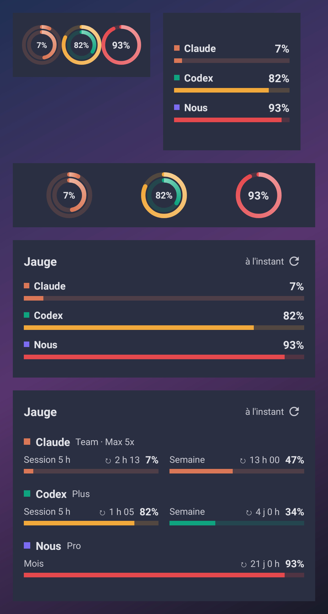
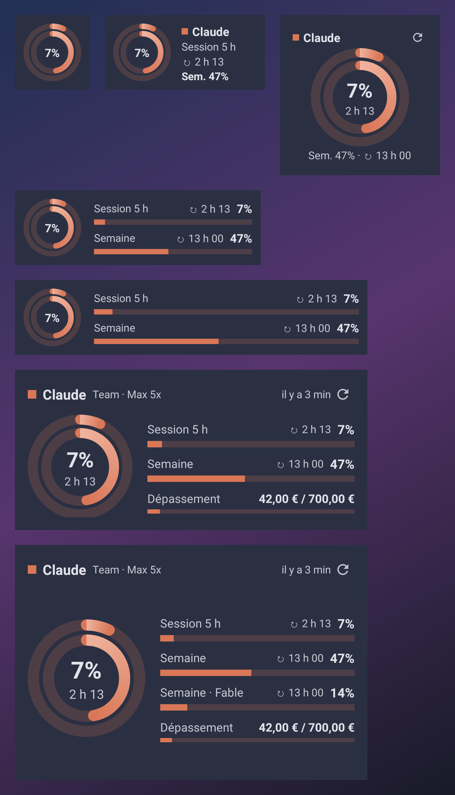
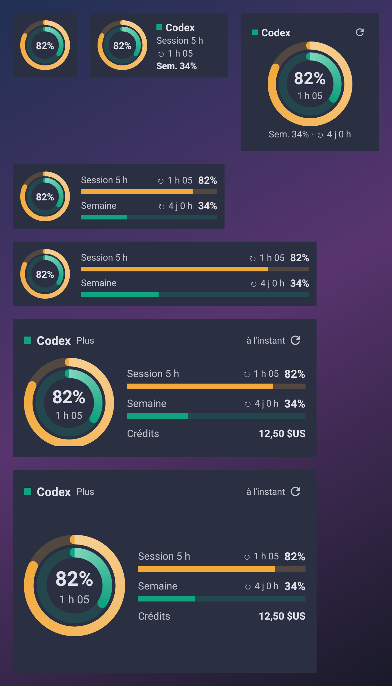
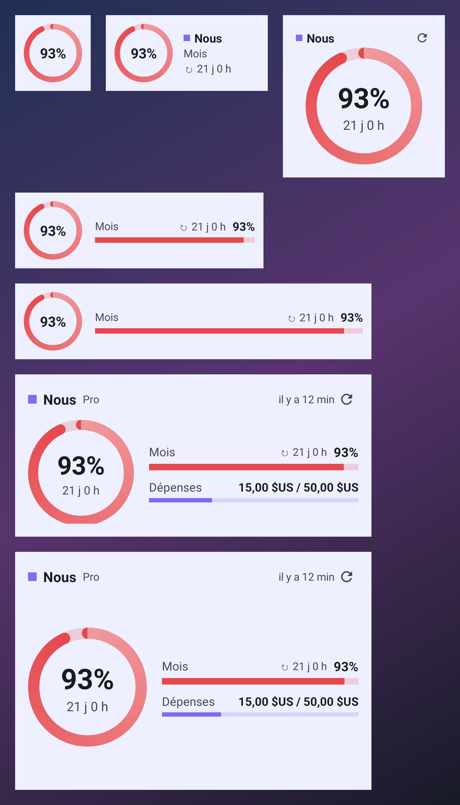

# Jauge

Widgets Android pour suivre d'un coup d'œil l'usage de vos abonnements IA : **Claude** (Pro, Max, Team), **ChatGPT Codex** et **Nous Portal** (Hermes Agent).

- Session de 5 h, limite hebdomadaire, limites par modèle, crédits mensuels
- Dépassement (« extra usage » Claude, crédits Codex, dépenses et top-up Nous)
- Compte à rebours avant chaque réinitialisation
- Connexion OAuth directe depuis l'application, sans clé d'API
- Widgets redimensionnables de 1×1 à 4×3 : la mise en page s'adapte à la place disponible
- Couleurs Material You, thème clair et sombre, jauges qui passent à l'orange à 75 % puis au rouge à 90 %
- Fréquence d'actualisation réglable (5 min à 4 h), Wi‑Fi uniquement en option

Android 12 (API 31) ou plus récent.

## Aperçu

| Vue d'ensemble | Claude |
| --- | --- |
|  |  |

| Codex | Nous Portal |
| --- | --- |
|  |  |

Les aperçus sont générés par `WidgetPreviewTest` (Robolectric) à partir de données de démonstration ; sur le téléphone, les coins sont arrondis et les couleurs suivent votre fond d'écran.

## Installation

1. Sur le téléphone, ouvrez la [dernière release](https://github.com/Sygix/Jauge/releases/latest) et téléchargez `Jauge-vX.Y.Z.apk`.
2. Autorisez l'installation depuis le navigateur si Android le demande, puis installez.
3. Ouvrez Jauge, connectez vos comptes, puis ajoutez un widget (bouton « Widgets » de l'app ou appui long sur l'écran d'accueil).

Les mises à jour s'installent par-dessus la version précédente : l'APK est toujours signé avec la même clé.

## Connexion des comptes

| Service | Méthode | Ce qui est lu |
| --- | --- | --- |
| Claude | OAuth PKCE dans le navigateur, retour automatique vers l'app (saisie manuelle du code en secours) | `api.anthropic.com/api/oauth/usage` et `/api/oauth/profile` |
| ChatGPT Codex | OAuth PKCE dans le navigateur (port local 1455) ou code appareil | `chatgpt.com/backend-api/wham/usage` |
| Nous Portal | Code appareil | `portal.nousresearch.com/api/oauth/account` |

Pendant une connexion par navigateur, une notification « Connexion en cours… » garde l'app active le temps de recevoir la réponse sur `localhost`.

Les jetons sont chiffrés avec une clé AES de l'Android Keystore et ne quittent jamais le téléphone. Aucune sauvegarde cloud n'est autorisée. Jauge ne contacte que les services ci-dessus.

Pour Codex en code appareil, ChatGPT peut demander d'activer l'autorisation par code appareil dans ses paramètres de sécurité.

## Avertissement

Jauge n'est affiliée ni à Anthropic, ni à OpenAI, ni à Nous Research. Elle utilise les mêmes identifiants OAuth publics et les mêmes endpoints que les CLI officielles (Claude Code, Codex CLI, Hermes Agent). Ces endpoints ne sont pas documentés : ils peuvent changer sans préavis, et leur usage par un outil tiers relève des conditions de chaque service. Jauge ne fait que lire l'usage, elle n'envoie aucune requête de modèle.

## Actualisation

WorkManager relance la lecture selon la fréquence choisie. Android peut retarder ces exécutions en économie d'énergie ou en Doze. Le bouton ↻ des widgets et l'ouverture de l'app forcent une actualisation immédiate. En cas d'échec, le widget garde les dernières valeurs et affiche ⚠.

## Développement

Kotlin, Jetpack Compose (app), Glance (widgets), WorkManager, OkHttp, DataStore.

```sh
./gradlew testDebugUnitTest assembleDebug
```

`testDebugUnitTest` couvre les parseurs des trois API et génère les aperçus des widgets dans `app/build/widget-previews/`.

Release : pousser un tag `vX.Y.Z` lance `.github/workflows/release.yml`, qui construit l'APK signé et le publie dans les releases. Secrets requis : `JAUGE_KEYSTORE_BASE64`, `JAUGE_STORE_PASSWORD`, `JAUGE_KEY_ALIAS`, `JAUGE_KEY_PASSWORD`.

## Licence

AGPL-3.0-or-later, voir [LICENSE](LICENSE).
