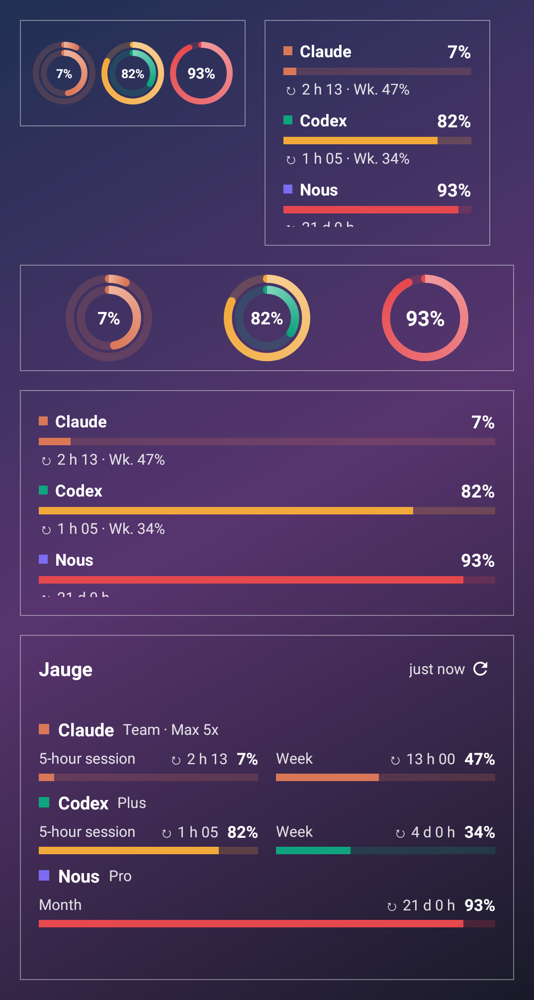
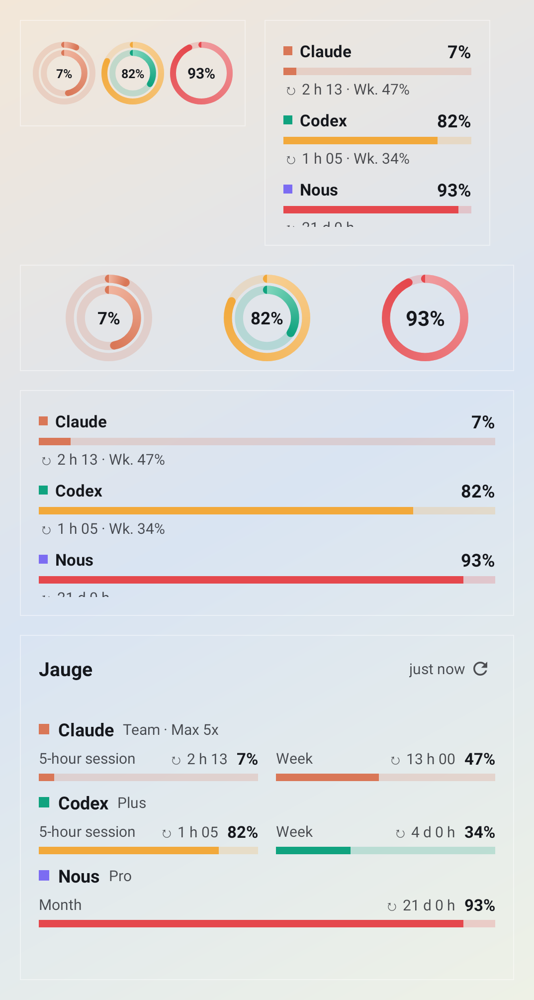
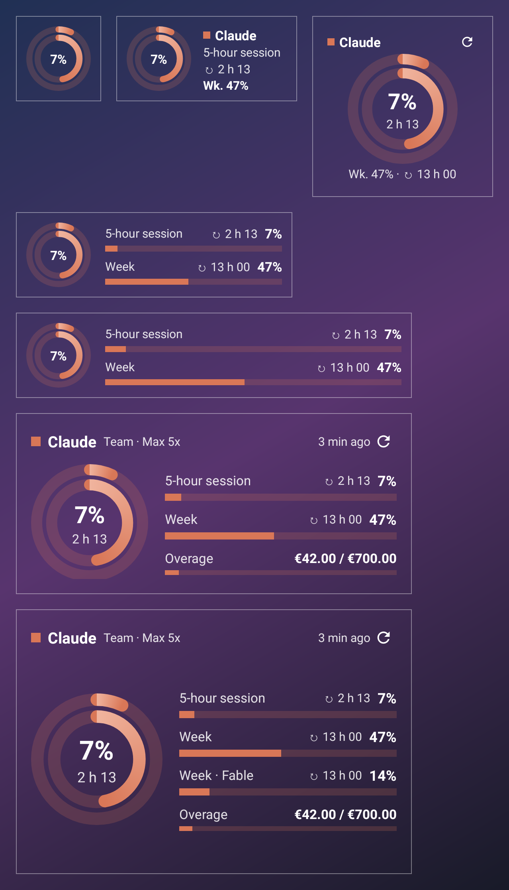
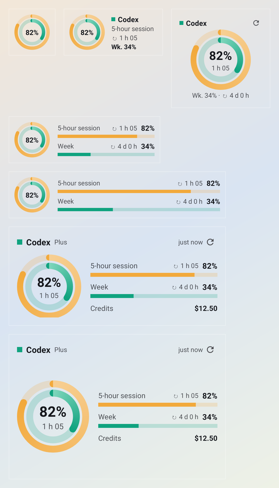
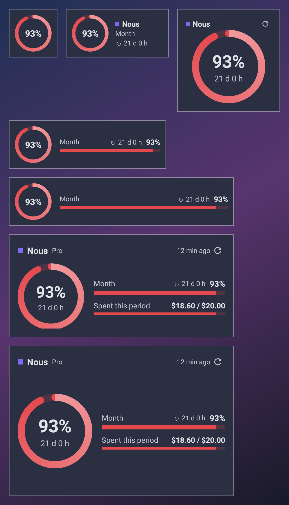

# Jauge

Android home screen widgets to keep an eye on your AI subscriptions: **Claude** (Pro, Max, Team), **ChatGPT Codex** and **Nous Portal** (Hermes Agent).

- 5-hour session, weekly limit, per-model limits, monthly credits
- Overage and spend: Claude extra usage, Codex credits, Nous spend over the billing period and top-up balance
- Countdown to every reset
- Direct OAuth sign-in from the app, no API key needed
- Resizable widgets from 1×1 to 4×3, the layout adapts to the space you give it
- Transparent widgets that sit on your wallpaper, with light, dark or automatic text (or a Material You background if you prefer)
- Gauges turn orange at 75 % and red at 90 %
- Configurable background refresh (5 min to 4 h), optional Wi‑Fi only
- English and French

Requires Android 12 (API 31) or later.

## Preview

| Overview, light text | Overview, dark text |
| --- | --- |
|  |  |

| Claude | Codex | Nous Portal with background |
| --- | --- | --- |
|  |  |  |

These previews are rendered by `WidgetPreviewTest` (Robolectric) from demo data. The thin frames only mark the widget bounds; on a phone, corners are rounded and the optional background follows your wallpaper colors.

## Install

1. On your phone, open the [latest release](https://github.com/Sygix/Jauge/releases/latest) and download `Jauge-vX.Y.Z.apk`.
2. Allow installs from your browser if Android asks, then install.
3. Open Jauge, sign in to your accounts, then add a widget (Widgets button in the app, or long press on the home screen).

Updates install over the previous version: every APK is signed with the same key.

## Signing in

| Service | Method | What is read |
| --- | --- | --- |
| Claude | OAuth PKCE in the browser with an automatic return to the app, manual code entry as a fallback | `api.anthropic.com/api/oauth/usage` and `/api/oauth/profile` |
| ChatGPT Codex | OAuth PKCE in the browser (local port 1455) or device code | `chatgpt.com/backend-api/wham/usage` |
| Nous Portal | Device code | `portal.nousresearch.com/api/oauth/account` |

While a browser sign-in is pending, a "Signing in…" notification keeps the app alive long enough to receive the answer on `localhost`.

Tokens are encrypted with an AES key from the Android Keystore and never leave the phone. Cloud backup is disabled. Jauge only talks to the services above.

For Codex with a device code, ChatGPT may ask you to enable device code authorization in its security settings.

## Disclaimer

Jauge is not affiliated with Anthropic, OpenAI or Nous Research. It uses the same public OAuth clients and endpoints as the official command line tools (Claude Code, Codex CLI, Hermes Agent). These endpoints are undocumented: they can change without notice, and using them from a third-party tool is subject to each service's terms. Jauge only reads usage, it never sends model requests.

## Refresh

WorkManager reads usage again at the interval you choose. Android may delay these runs in battery saver or Doze. The ↻ button on widgets and opening the app force an immediate refresh. If a refresh fails, the widget keeps the last values and shows ⚠.

## Development

Kotlin, Jetpack Compose (app), Glance (widgets), WorkManager, OkHttp, DataStore.

```sh
./gradlew testDebugUnitTest assembleDebug
```

`testDebugUnitTest` covers the three API parsers and the translations, and renders every widget at every size into `app/build/widget-previews/`, including a size matrix to catch clipped layouts.

Releases: pushing a signed `vX.Y.Z` tag runs `.github/workflows/release.yml`, which builds the signed APK in the `production` environment and publishes it on the Releases page.

See [CONTRIBUTING.md](CONTRIBUTING.md) and [SECURITY.md](SECURITY.md).

## License

AGPL-3.0-or-later, see [LICENSE](LICENSE).
